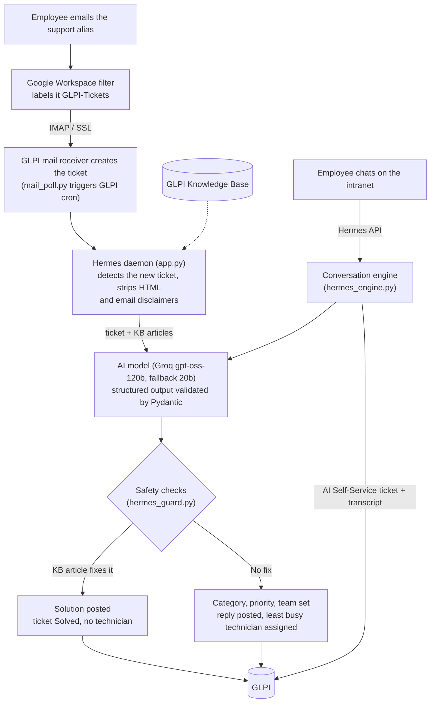

# Hermes: AI Service Desk Agent for GLPI

Hermes automates first-line IT support on top of [GLPI](https://glpi-project.org/). It reads every new ticket, categorises and prioritises it, routes it to the right team and technician, replies to the requester, and solves it outright when the Knowledge Base already holds the fix. Employees can also chat with Hermes, which diagnoses the issue and only involves a technician when one is needed.

> **Status:** proof of concept, running against a local GLPI 10.0.27 instance on test data. See [Production readiness](#production-readiness) for what remains before real employee data is used.

---

## The process it automates

### Before Hermes

Every incoming email was handled by a person:

1. A helpdesk agent reads the email.
2. They decide what it is about and pick a category.
3. They judge urgency and impact and set a priority.
4. They choose a support team and a technician.
5. They write a first reply to the requester.
6. Known issues with documented fixes still wait in the queue for a technician.

### With Hermes



| Step | What Hermes does |
|---|---|
| **Intake** | Email becomes a GLPI ticket with no human involved. Hermes picks up every New ticket, including ones from the Helpdesk form (a category the user chose is kept if it fits, otherwise corrected with a note). |
| **Clean-up** | Strips HTML and confidentiality disclaimers so only the user's own words reach the AI. Skips recalls, forwarded notifications and system mailboxes. |
| **Triage** | The AI returns a fixed form: category, support group, urgency and impact (GLPI's 1 to 5 scales), incident or request, a one-line summary, whether a Knowledge Base article resolves it, and a draft reply. Categories are read live from GLPI, so new categories need no code change. |
| **Self-resolution** | If a Knowledge Base article that really exists fixes the issue, Hermes posts it as the solution and GLPI marks the ticket Solved. |
| **Escalation** | Otherwise Hermes sets category and priority, assigns the group, posts a public reply and assigns the technician in that group with the fewest open tickets (rule-based, read live from GLPI, skipping technicians on leave). |
| **Chat** | Employees describe the issue in chat. Hermes asks up to two rounds of diagnostic questions, offers the documented fix, and asks "Is your issue resolved?". Yes closes the ticket; No assigns a technician with the full transcript attached. Urgent issues go straight to a technician. |
| **Every chat is recorded** | Each conversation becomes one "AI Self-Service" ticket once Hermes understands the issue, so usage, frequent issues and resolution rate can be reported. Self-service tickets with no activity for 24 hours close automatically. |
| **Continuous improvement** | Hermes suggests new categories when tickets fit nowhere and flags tickets routed to the wrong team. Service desk leads approve or decline these in a console; approved changes are applied in GLPI and audited. |
| **Weekly reporting** | The weekly service desk report (new, brought forward, resolved, SLA compliance, handling time, per technician) is produced straight from GLPI and exported to Excel, replacing a hand-built spreadsheet. |

---

## Results achieved

| Area | Result |
|---|---|
| **End-to-end automation** | The full loop works without a person: email in, ticket created, categorised, prioritised, routed, technician assigned, requester answered. Known issues are solved in the same cycle the ticket is created. |
| **Zero-touch triage** | Category, urgency, impact, ticket type, team and technician are set on every ticket. No dispatcher is needed. |
| **Response speed** | The AI answers in **2 to 4 seconds** per ticket on Groq (Gemini's free tier ranged from 12 to almost 100 seconds under load, so Groq was chosen as primary). |
| **Low running cost** | Measured at about 1,000 input and 600 output tokens per request. At a conservative 10,000 requests a month, the current model costs **about $5 a month**. See [ai-model-evaluation.md](docs/ai-model-evaluation.md). |
| **Safety, tested** | **39 automated tests** prove what Hermes must never do (change GLPI while paused, send unapproved links, ask for passwords, leak other people's details, claim actions it did not take, mark a ticket solved without a real article). A red-team pack runs prompt-injection, phishing and jailbreak attempts through the real AI. All 39 tests pass. |
| **Ready for 1,000+ employees** | GLPI silently cuts results above 1,000 items, so Hermes reads in pages. Running independent reads side by side cut the service desk console load time from **12 to 21 seconds to 5 to 6 seconds**. |
| **More accurate reporting** | The automated weekly report fixed errors in the hand-made spreadsheet: it uses the solve date instead of "last update" (which inflated handling time and SLA breaches), stops counting open tickets as "SLA met", separates old backlog, and credits every technician on a shared ticket. |
| **Intranet integration** | The Hermes API powers a chat launcher, an IT Support page, "My tickets", notifications and an IT Service Desk console (category and routing suggestions, technician availability, audit log, data protection) in the company intranet. |
| **Data protection built in** | Chats deleted 12 months after the last message; one person's data can be exported or deleted on request; the change log stores field values only, never message text. |

Mean time to resolution and staff-time savings are expected benefits but have **not yet been measured against a baseline**. Measuring them is part of production rollout.

---

## Safety design

The AI never touches GLPI directly. It only fills in a fixed form, and Hermes' own code decides what to do within fixed rules. The worst a manipulated AI can do is get one ticket's category or priority wrong, and the reply checks stop bad replies.

- **Off switch** that refuses every change to GLPI at once and survives a restart.
- **Rate limits** (400 changes an hour, 30 per ticket) that pause Hermes automatically if exceeded.
- **Reply checks** that withhold replies containing unapproved links, password requests, unknown contact details, unsafe advice, leaked instructions or web page code.
- **No false claims**: a reply saying something was done is withheld unless Hermes' code actually did it.
- **Read-only (shadow) mode** for comparing Hermes' decisions with the service desk's on production, without writing anything.
- **Change log** of every write, kept 90 days.

Details: [docs/safety.md](docs/safety.md).

---

## Project layout

| File | Purpose |
|---|---|
| [app.py](app.py) | GLPI client, AI analysis, triage, routing and the ticket polling loop |
| [server.py](server.py) | Starts the poller and the Hermes API (local machine only) |
| [hermes_engine.py](hermes_engine.py) | Chat conversation rules, independent of any front end |
| [hermes_api.py](hermes_api.py) | Conversation API used by the intranet |
| [hermes_admin_api.py](hermes_admin_api.py) | API for the IT Service Desk console |
| [hermes_guard.py](hermes_guard.py) | Safety controls: off switch, limits, reply checks, change log |
| [hermes_routing.py](hermes_routing.py) | Routing suggestions and technician availability |
| [hermes_report.py](hermes_report.py) | Weekly service desk report |
| [hermes_store.py](hermes_store.py) | Hermes' own data store (chats, suggestions, audit log) |
| [mail_poll.py](mail_poll.py) | Triggers GLPI's mail receiver on a short interval |
| [portal.py](portal.py), [pages/](pages/) | Streamlit test portal and analytics (prototype; the intranet replaces it) |
| [tests/](tests/) | Safety unit tests and the red-team pack |
| [docs/](docs/) | Architecture, GLPI setup, safety, AI model evaluation, backlog |

---

## Getting started

Requirements: Python 3.11+, a GLPI 10 instance with the REST API enabled, and a Groq API key.

```bash
python -m venv venv
venv\Scripts\activate            # Windows  (source venv/bin/activate on Linux/macOS)
pip install -r requirements.txt

cp .env.example .env             # then fill in the GLPI tokens and API key
python server.py                 # ticket poller + Hermes API on localhost:8000
python mail_poll.py              # optional: trigger GLPI mail intake (test environments only)
streamlit run portal.py          # optional: Streamlit test portal
```

GLPI setup (categories, groups, the restricted "Hermes API" profile, mail receiver, SLAs): [docs/glpi-configuration-guide.md](docs/glpi-configuration-guide.md).

### Running the tests

```bash
# Unit tests: no GLPI or AI needed
PYTHONIOENCODING=utf-8 python -m unittest discover -s tests -v

# Red-team pack: sends made-up attacks to the AI provider, writes nothing to GLPI
python tests/safety_pack.py
```

On Windows, set `PYTHONIOENCODING=utf-8` (or `$env:PYTHONIOENCODING="utf-8"` in PowerShell) so the console can print the status emoji.

---

## Production readiness

Before real employee data is used:

- A paid AI provider with a signed data processing agreement and no-training terms (shortlist: Google Cloud Vertex AI, or Groq with zero data retention). The free-tier Gemini fallback stays switched off.
- Legal review of data transfers under Nigeria's Data Protection Act 2023, and a data protection impact assessment.
- A separate GLPI account for category changes, certificate verification on the mail receiver, HTTPS everywhere, a secrets store, and chat history on an encrypted database server.

Full list and roadmap (event-driven intake via GLPI webhooks, vector search for a large Knowledge Base, Google Chat app): [docs/hermes-backlog-and-plan.md](docs/hermes-backlog-and-plan.md) and [docs/architecture-blueprint.md](docs/architecture-blueprint.md).
