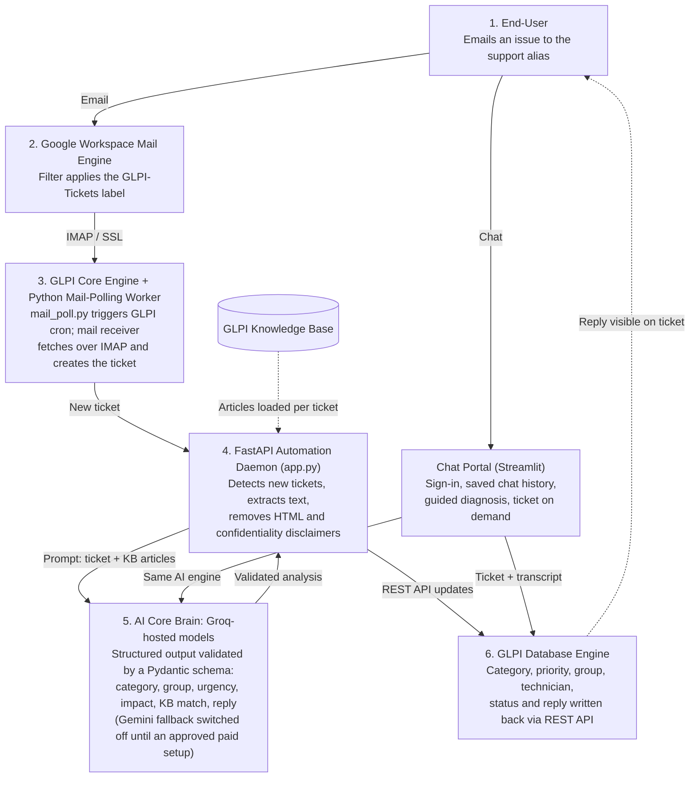

# Hermes: Intelligent AI-Driven ITIL Service Desk

**Technical System Architecture and Implementation Blueprint**

Hermes is the SBC IT service desk assistant: the AI engine that triages tickets in GLPI and the chat assistant employees talk to in the portal.

Status: proof of concept, running against a local GLPI 10.0.27 instance. Sections 1 to 3 and 5 describe the system as built. Section 4 describes the target production environment. Section 6 is the forward roadmap.

---

## SECTION 1: EXECUTIVE SUMMARY & SYSTEM OVERVIEW

Hermes replaces manual first-line triage with an autonomous pipeline. Today, a helpdesk agent reads every incoming email, decides what it is about, sets a priority, picks a team and writes a first reply. In the new model, an incident emailed to the support alias becomes a GLPI ticket without human involvement, and an AI engine then categorizes it, sets urgency and impact, routes it to the correct support group, assigns the least busy technician in that group, and replies to the requester. Where the internal Knowledge Base already contains the fix, the AI posts it as the ticket's solution and the ticket is marked Solved with no technician involved.

A companion chat portal gives employees a second entry point. The assistant asks diagnostic questions, offers the documented fix when one exists, and only raises a ticket when one is needed, carrying the full conversation into GLPI so the technician does not have to re-ask. The proof of concept demonstrates the complete loop end to end: email ingestion, AI triage, self-resolution, load-balanced assignment and requester communication.

**Core business value**

| Value driver | How the system delivers it |
|---|---|
| Lower mean time to resolution (MTTR) | Known issues are answered from the Knowledge Base in the same cycle the ticket is created; escalated tickets arrive already categorized, prioritized and assigned. |
| Zero-touch prioritization | Category, urgency and impact are set by the AI against a fixed service catalog and GLPI's 1 to 5 scales. No dispatcher is needed. |
| Load-balanced technician assignment | Each escalated ticket goes to the active member of the target group with the fewest open tickets, read live from GLPI. |
| Cost efficiency | First-line triage effort is removed for every ticket; the AI layer runs on low-cost model tiers with an automatic fallback provider. |

MTTR and cost figures are expected benefits. They have not yet been measured against a baseline; doing so is part of production rollout.

---

## SECTION 2: ARCHITECTURAL DIAGRAM & WORKFLOW SPECIFICATION

**Incident data lifecycle**

- **1. Trigger.** An employee emails the support alias describing the issue.
- **2. Mail routing.** A Google Workspace filter labels the message `GLPI-Tickets`, keeping it out of the main inbox and in the folder GLPI reads.
- **3. Ingestion.** `mail_poll.py` pings GLPI's cron endpoint on a short interval. GLPI's mail receiver connects to the mailbox over IMAP/SSL, pulls the labelled message and creates a ticket with status New and no category.
- **4. Detection and clean-up.** The automation daemon polls GLPI for New tickets, whether or not the requester chose a category (a category chosen in the Helpdesk form is kept if it fits, otherwise corrected, and the change is recorded in the technicians' note). Tickets created before Hermes was switched on are left alone. For each ticket it strips HTML markup and cuts the email confidentiality disclaimer so only the user's own words reach the model.
- **5. AI analysis.** The daemon sends the ticket text and the Knowledge Base articles to a Groq-hosted model (`gpt-oss-120b`, then `gpt-oss-20b`). The model returns a structured result that is validated against a Pydantic schema: category, support group, urgency, impact, a one-line summary, whether a Knowledge Base article resolves the issue, and a drafted reply. If the Groq models are unavailable or rate limited, the same request can be retried on Gemini 3.8 Flash. That fallback is switched off by default, because a free-tier Gemini key lets Google use the content to improve its products; it is only enabled for a paid, approved setup. Groq is primary because it answered in 2 to 4 seconds in testing, while Gemini's free tier ranged from 12 to almost 100 seconds under load.
- **6a. Self-resolution.** If a Knowledge Base article resolves the issue, the daemon sets category and priority, assigns the group, and posts the answer as the ticket's solution. GLPI marks the ticket Solved.
- **6b. Escalation.** Otherwise the daemon sets category and priority, assigns the group, posts a public reply to the requester, sets the ticket to Assigned, and assigns the least busy technician in the group.
- **Technician selection is rule-based, not AI-based.** The AI chooses the group; the daemon reads group membership and open-ticket counts from GLPI and picks the person. This keeps assignment predictable and makes load balancing possible.
- **Event model.** GLPI 10 cannot push outgoing webhooks, so the daemon polls. The daemon also exposes an HTTP endpoint that accepts a ticket ID, used for manual triggering today and ready for push events after a GLPI upgrade (see Section 6, Phase 1).

**Chat portal path**

- The employee signs in and describes the issue in chat. The full conversation is sent to the AI on every turn and saved, so it can be reopened later.
- Every conversation is recorded in GLPI as one "AI Self-Service" ticket as soon as Hermes understands the issue (greetings and vague openers are not recorded). The ticket stays Pending, with no technician, while Hermes and the user talk, and every exchange is added to its timeline.
- The signed-in user is set as the ticket's requester when their email matches a GLPI user.
- Knowledge Base match: the fix is posted as the ticket's solution and the user is asked "Is your issue resolved?". Yes closes the ticket; No assigns it to a technician.
- No match: Hermes asks up to two rounds of diagnostic questions, then asks whether the user needs a technician.
- High urgency, or an explicit request for a technician, assigns the ticket straight away.
- 24-hour rule: a self-service ticket with no activity for 24 hours (a solution nobody answered, or an abandoned chat) is closed automatically. A message after closure starts a new ticket linked to the closed one.

---

## SECTION 3: SYSTEM INTEGRATIONS & DATA PROTOCOLS

| Component Pair | Interface Protocol | Authentication Mechanism | Primary Data Transferred |
|---|---|---|---|
| Google Mail to GLPI Mailgate (mail receiver) | IMAP over SSL, port 993, `GLPI-Tickets` folder | Mailbox login with an application-specific password | Inbound support emails: sender, subject, body, attachments |
| Python Mail-Polling Worker to GLPI cron | HTTP GET to `front/cron.php` on the local host | None (local loopback only) | Trigger only; no payload |
| Python Daemon to GLPI REST API | HTTPS/HTTP REST with JSON payloads (`apirest.php`) | `App-Token` plus `user_token`, exchanged for a `Session-Token` | Ticket reads; category, urgency, impact, status updates; group and technician actors; follow-ups; solutions; Knowledge Base articles |
| Python Daemon to Groq (primary AI) | HTTPS REST, OpenAI-compatible chat completions | Bearer API key from the `GROQ_API_KEY` environment variable | Prompt (ticket text plus Knowledge Base context); structured JSON analysis |
| Python Daemon to Gemini (fallback AI, switched off by default) | HTTPS REST via the Google GenAI SDK | API key from the `GEMINI_API_KEY` environment variable; only used when `GEMINI_FALLBACK_ENABLED=true`, which is reserved for a paid, approved Gemini or Vertex AI setup | Same prompt and JSON analysis as Groq |
| GLPI Native Webhook to FastAPI Daemon | HTTP POST to `/glpi-webhook` on local port 8000 | None (local loopback only) | Ticket ID. Not active on GLPI 10, which has no outgoing webhooks; the endpoint is used for manual triggering and reserved for Phase 1 |
| Chat Portal to Google Workspace (identity provider) | OpenID Connect (authorization code flow) | Google OAuth client ID and client secret; signed session cookie | User identity: name and email. Demo sign-in is used until the Google OAuth client is registered |
| Chat Portal to chat history store | Local SQLite file | File system access | Conversations, linked ticket IDs and outcomes per user |

All secrets are held in a local `.env` file (API keys, GLPI tokens) or `.streamlit/secrets.toml` (identity provider credentials) and are never written into source code.

---

## SECTION 4: PRODUCTION ENVIRONMENT SOFTWARE & HARDWARE REQUIREMENTS

This is the target specification for a Windows Server deployment on IIS. The proof of concept currently runs on Apache 2.4 with PHP 8.2 and Python 3.14 on a workstation.

| Layer | Requirement |
|---|---|
| Operating System | Windows Server 2022, Datacenter or Standard edition |
| Web Server | IIS (Internet Information Services) with the CGI feature enabled and the Microsoft URL Rewrite Module installed |
| Runtime | PHP 8.3 Non-Thread Safe (NTS), run through FastCGI, with extensions `intl`, `mysqli`, `openssl`, `gd`, `curl` and `zip` enabled |
| Database | MySQL or MariaDB backend for GLPI |
| Automation | Python 3.11 or later in a virtual environment (`venv`); the daemon (`app.py`) and the chat portal run as background Windows Services managed by NSSM (Non-Sucking Service Manager) |
| Polling Engine | Windows Task Scheduler running the mail-polling job (`mail_poll.py`) at 1-minute intervals |
| Network | Outbound HTTPS to the Gemini and Groq APIs and to the identity provider; outbound IMAP/SSL (993) to Google; HTTPS with a valid certificate on the portal hostname, which single sign-on requires |

**Indicative sizing** for a single-server deployment serving a few hundred employees: 4 vCPU, 16 GB RAM, 100 GB SSD. The AI workload runs in the cloud, so the server carries only GLPI, the database and three lightweight Python processes. Confirm sizing against expected ticket volume before procurement.

**Production hardening items carried over from the proof of concept**

- Run the automation under a dedicated GLPI account with a narrow profile. The proof of concept uses a Super-Admin account.
- Configure SMTP and enable GLPI notifications so requesters and technicians are emailed. Both are currently off.
- Replace the SQLite chat history file with a database server.
- Move both AI providers from free tiers to paid plans with agreed quotas.
- Put the daemon's HTTP endpoint behind authentication before it is reachable beyond the local host.

---

## SECTION 5: ITIL MATRICES & AUTOMATION LOGIC

**Service Catalog Matrix**

Hermes reads the category list live from GLPI (refreshed every five minutes), so categories added or renamed in GLPI are used without any code change. Only the most specific categories are offered; a parent category that has sub-categories is too vague to assign. The table shows the catalogue at the time of writing. When no category fits, Hermes leaves the ticket uncategorised and records a suggested new category in the technicians' note, which feeds the category review (backlog item F2).

| AI Category Name | GLPI Category (parent > child) | GLPI Database ID |
|---|---|---|
| Password Reset | Identity & Access Management > Password Reset | 4 |
| Folder Permissions Request | Identity & Access Management > Folder Permissions Request | 5 |
| Email Access Issue | Application Services > Email Access Issue | 6 |
| Core Application Crash | Application Services > Core Application Crash | 7 |
| Wi-Fi Connectivity Drop | Infrastructure Services > Wi-Fi Connectivity Drop | 8 |
| New Laptop Request | Infrastructure Services > New Laptop Request | 9 |
| General / Unknown | Left uncategorized | 0 |

**Roster & Resource Assignment**

| AI Group Label | GLPI Group | Group ID | Engineer | Role | User ID |
|---|---|---|---|---|---|
| Tier_1 | Service Desk - Tier 1 | 1 | Alex | Tier 1 Triage | 8 |
| Tier_2 | SysAdmin Team - Tier 2 | 2 | Sarah | Tier 2 SysAdmin | 9 |
| Network | Network Team | 3 | Sam | Network Specialist | 10 |

Engineers are not hardcoded. The daemon reads each group's members from GLPI at assignment time, so adding a technician to a group in GLPI places them in the rotation automatically. Among active members, the one with the fewest open tickets (any status other than Solved or Closed) is assigned; ties go to the lowest user ID.

**Priority and decision rules**

| Rule | Behaviour |
|---|---|
| Urgency and impact scale | GLPI's 1 to 5 scale (Very Low to Very High). 4 or 5 is reserved for several users blocked or business-critical work stopped. |
| Knowledge Base match | Ticket solved by the AI; status Solved; no technician assigned. |
| No Knowledge Base match | Public reply posted; status Assigned; group and least busy technician assigned. |
| Portal: urgency 4 or 5 with no fix | Ticket logged immediately, without asking the user. |
| Portal: issue unclear | Up to two rounds of diagnostic questions before a ticket is offered. |
| Processing failure | Retried on the next polling cycle, up to three attempts per ticket. |

**Service Level Agreement (SLA) Matrix**

SLA automation is not yet part of the delivered system. One rule has been defined in GLPI as a starting point; attaching it to tickets automatically is future work.

| SLA | Type | Target | Escalation | Status |
|---|---|---|---|---|
| Network High Priority: "3rd Floor/Infrastructure Resolve Goal" | Time to Resolve (TTR) | 2 hours | One reminder level ("Automatic Reminder") | Defined in GLPI; not yet attached to any ticket |

Intended behaviour once configured: a high-priority network incident, such as a floor-wide wireless drop, receives the 2-hour TTR rule at triage, GLPI starts the countdown, and reminder and escalation levels fire as the deadline approaches.

---

## SECTION 6: EXECUTIVE PROJECT ROADMAP

Timelines are indicative and start from production go-ahead.

**Phase 1: Native Event-Driven Architecture (Weeks 1 to 4)**

- Replace polling with direct push: GLPI calls the daemon the moment a ticket is created.
- Route: upgrade to GLPI 11, which has native outgoing webhooks, or install a webhook plugin on GLPI 10.
- The receiving endpoint already exists in the daemon; the work is on the GLPI side plus endpoint authentication.
- Outcome: ticket-to-triage delay drops from the polling interval to near real time, and the polling load on GLPI is removed.

**Phase 2: Vector Embeddings & RAG Optimization (Weeks 5 to 10)**

- Today every Knowledge Base article is sent to the model with every ticket. That works for a small Knowledge Base and does not scale.
- Deploy a local vector database (ChromaDB or FAISS), embed the corporate documentation, and retrieve only the most relevant passages per ticket.
- Outcome: the Knowledge Base can grow to thousands of documents with stable cost, latency and answer quality.

**Phase 3: Omnichannel Conversational Frontends (Weeks 11 to 16)**

- Take the conversation logic proven in the Streamlit portal (guided diagnosis, fix confirmation, ticket on demand) to the channel employees already use: Google Chat, as a Chat app in the company's Google Workspace.
- Reuse the same AI engine and GLPI integration; only the front end changes. Users are already signed in to Workspace, so the app knows who is asking without a separate sign-in.
- Outcome: issues are diagnosed, and often resolved, in conversation before a ticket is ever logged.
